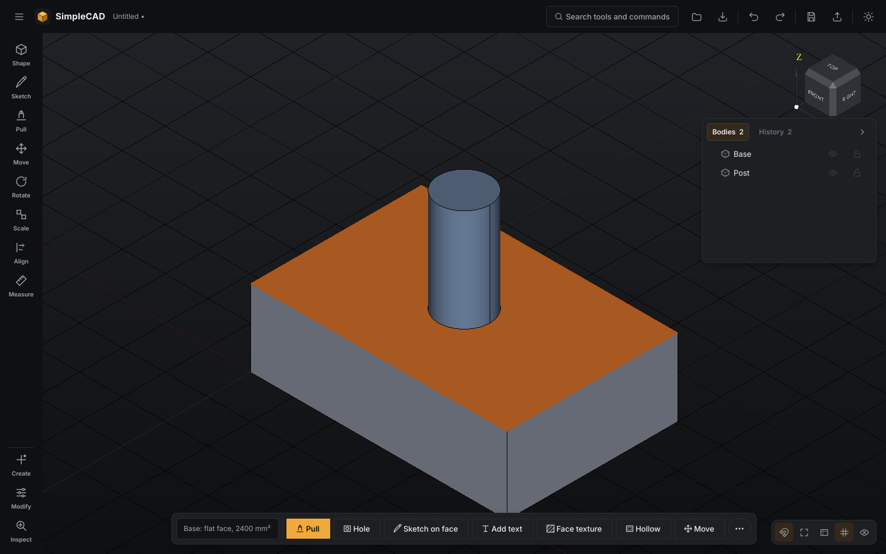
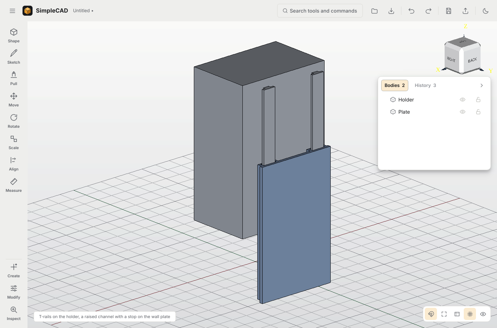
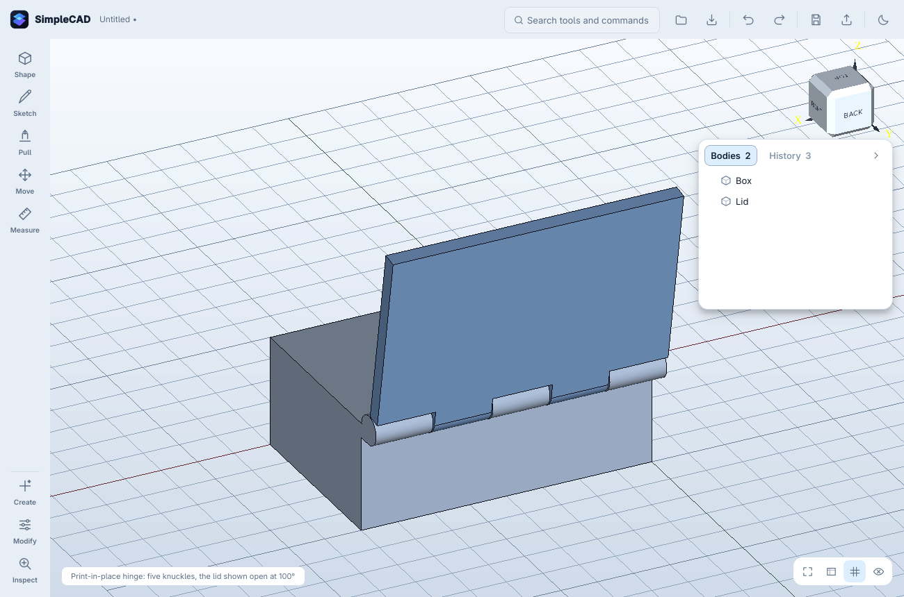

# SimpleCAD

Modern parametric CAD for Fedora, built for mechanical design and functional
3D printing.

**Easy by default. Powerful when needed.** The viewport is the application:
tools appear when they are relevant, panels float over the model rather than
boxing it in, and every dimension accepts an expression as readily as a number.



## What works today

**The full workflow runs end to end**, verified by `scripts/acceptance_ui.py`
driving the real UI:

```
Create Box → Pull Face → Create Second Part → Stack Faces →
Add Hole → Create Automatic Thread Pair → Fillet → Export
```

| Area | State |
|---|---|
| **Viewport** | OCCT rendering into Qt's framebuffer, so panels composite over the model. **Drag a box** over the model to select everything it catches — left to right takes only what it surrounds, right to left takes anything it touches, and Shift or Ctrl adds to what is already selected. Edges and corners are given pick zones wider than the lines that draw them, and a click is taken from where the button went *down*, so aiming at an edge and lifting a pixel to one side does not select the face behind it. Hover and selection use OCCT's native face/edge/vertex shading — no bounding rectangles around the part. ViewCube, ortho & perspective, six standard views, zoom to fit & to selection. A **ground grid** at 10 / 50 mm gives depth and position a reference, and every body gets its own tint so two parts are never one silhouette |
| **Camera** | **Turntable orbit around what you are looking at** — the selection, or whatever is under the cursor — so the thing you are inspecting stays put while you sweep around it. The up vector is re-derived from the view direction every frame, so roll is not merely small but exactly zero and the horizon can never end up crooked; pitch stops short of the poles, so the model never flips. Middle-drag pans; Shift+middle-drag or Alt+left-drag orbits; Ctrl+Shift plus a trackpad swipe pans in both axes; and the wheel zooms at the cursor with a step taken from the size of the gesture. Pinch zooms where the platform offers it. Standard views and the ViewCube **sweep** to the new orientation instead of cutting, and re-aim without also re-framing |
| **Measure** | Two ways of asking. **Entities**: length, distance, angle, area, volume, radius, diameter, centre distance and minimum distance — dispatched from the selection, so picking two holes reports the pitch without choosing a mode. **Point to point**: a circular indicator follows the cursor and **snaps** to the places that mean something — corners, edge midpoints, arc and hole centres, face centres — and, where none of those is near, to the point on the face or along the edge the cursor is actually over, so the indicator never blinks out and a click never lands on nothing. What gets picked is exactly what the indicator was drawn on. The first point is filled and the second hollow, a rubber band follows the cursor with the running length, and the reading is drawn on the model |
| **Construction geometry** | Offset plane, midplane, plane at an angle, plane through points, tangent plane, axis and point — all parametric, so they follow the geometry they came from |
| **Direct manipulation** | Select a face and **drag it** to push/pull, with a live translucent preview and the **resulting size** shown at the cursor as you go — not just how far you have moved. **Round faces drag too**: pull the side of a shaft or a tube toward its axis and it gets thinner, with the resulting diameter at the cursor. The tool is a ring between the old and the new radius, never a solid cylinder, so a tube keeps its bore. Pushing inward turns the body translucent so the material being removed is actually visible, and the drag snaps to 0.25 mm (Shift for free, Ctrl for 0.05 mm) so landing on a round number is the default. **Fillet and Chamfer put a handle on the edge** and you pull the corner to size. **Letting go commits**, exactly as letting go of a dragged face does. The larger, screen-stable **transform gizmo** attaches to every selected body, shows the original positions as a ghost and reports live ΔX/ΔY/ΔZ beside the cursor, so a multi-object move has both direction and depth cues. **Move and Rotate stay open** after each drag and re-attach to the result, so a second turn needs no reselecting; a click on empty space keeps what the tool is working on. **Dragging an arrow changes that axis and nothing else, from any camera angle** — the gizmo solves every drag itself and applies the axis or plane constraint last, after snapping, so nothing can add sideways motion (tested from 26 camera directions in orthographic and perspective, in a real window). **X / Y / Z** lock a drag to one axis and **Shift+X / Y / Z** to a plane, mid-gesture. **World or Local axes**; **Move by** an offset or **Move to** coordinates of the centre or a corner; drags snap the part's reference point to the grid and to other parts' edges, centres, corners and holes. Rings turn through any angle on every axis (past 90° too), a ring seen edge-on still turns, small drags commit, and rotation snaps every 5 / 15 / 45 / 90° (Shift free, Ctrl whole degrees). Rotate turns about the selection centre (fixed for the session, so +45° then −45° comes back exactly), the world origin, a picked point, or **the axis of a picked edge, hole or face**; **Reset rotation** undoes every turn a part has had. Typed values preview as a ghost before Enter, a drag adds to typed values rather than replacing them, and a move that pushes a part into another says so |
| **Parametric core** | Global N-in/N-out feature graph, dependency-driven rebuild, named parameters and expressions, durable topological references, friendly errors, last-valid-model retention |
| **Primitives** | Box, Cylinder, Sphere, Cone, Torus, Tube, Wedge, Oval, Pill — created and sized without a sketch. **Triangle, Pentagon, Hexagon and Octagon** prisms as their own tiles (even-sided sized across flats, odd-sided by their corner circle), plus a Polygon prism for any other side count. Decorative **Star, Heart, Cross, Crescent and Lightning** silhouettes expose useful proportions and extrusion height. **Vent**: a hex grille for a fan, as a plate of its own or cut straight through a wall you already have |
| **Modelling** | Press/Pull, Move, Rotate, Scale, Fillet, Chamfer, **Hollow** (shell to a wall thickness — pick the face to open and a box becomes a bucket), Hole (simple, counterbore, countersink, threaded). **Fillets and chamfers stay editable**: click a rounded or bevelled edge and *Edit fillet / chamfer* appears — change the radius, switch fillet ↔ chamfer, use two distances or distance-and-angle (with Swap sides), or remove it to get the sharp edge back, without undoing anything after it. Select a flat face and **Add text** to raise a label or engrave it inward, with live preview, Sans/Serif/Monospace families, exact depth, face-local offsets and rotation |
| **Combine** | **Subtract**, Join and Intersect, worked the way they are everywhere else: select the bodies, and the bar leads with Subtract. The panel names which body is being cut and which are doing the cutting, with **Swap** to turn it round, so a destructive and asymmetric operation is never guessed at silently. Several tools at once, a live preview of the real result before anything is committed, and the cutter is **consumed** — it does not linger inside the part it just cut — unless **Keep tool bodies** says otherwise |
| **Split** | Cut a part into two independent bodies by **dragging a plane through it**. The plane carries five handles — one at its centre and one at the middle of each edge — so whichever way the model is turned there is one facing the camera, and the readout that follows it is the **resulting size of both halves**, live. X, Y, Z or the plane of a selected face; an exact position can be typed instead. While the tool is open the part is dimmed and **nothing highlights**: the subject is the plane, not the body, and a selection glowing through a translucent part competes with the one thing there is to look at. What comes out is two bodies, separately selectable, movable, groupable and deletable, and deleting one leaves the other |
| **Grouping** | Multi-select and **Group**: one thing to select, move, rotate, duplicate, hide and delete, with the bodies inside kept whole and separate — organisational, never a boolean union. Groups nest, and the model tree shows membership as a tree. Clicking a member selects the group; double-clicking reaches inside for the one object. Ungroup puts everything back. **A group exports as one object**: its members are written into a single 3MF object and a single build item, so the slicer sees the one thing that grouping them said it was |
| **Advanced modelling** | Sweep along a path, Loft between profiles, Draft, Mirror, and rectangular / circular / along-path patterns — all parametric, so changing a pattern count moves every copy |
| **3D Print workspace** | Elegoo Centauri Carbon 2 profile (256³ mm). Place on plate, Center, and Orient for printing. Printability analysis — build volume, watertightness, disconnected pieces, overhangs, thin walls, tiny features — reported as warnings that never block export. Export for Printing (3MF) and open straight in a detected slicer |
| **Sketching** | **Draw with the mouse** on any base plane — line, polyline, rectangle, centre-rectangle, circle, arc, polygon, slot, point — with snapping to existing points and the grid, and Horizontal/Vertical constraints inferred as you draw. **`D → click → type → Enter`** dimensions geometry on the canvas; dimensions are clickable labels and editing one re-solves the sketch. Parametric throughout: 16 constraint types, a Levenberg–Marquardt solver, and state read from the Jacobian's rank so *Fully constrained* actually means it. Extrude and Revolve build from the result |
| **Align / Stack / Mate** | Stack, Center and Concentric with Flip and normal offset. Pick the moving part and a flat target face, then drag its preview or enter distances from the visually displayed left/right and top/bottom edges. Distances measure the part's outline to the face boundary; on-screen guides show both measurements; placement axes stay fixed when you orbit or refresh geometry. Face corners, edges, centres, holes and nearby bodies are magnetic drag targets. Placement stays pending until Done and rebuilds with the target face. The earlier anchor and signed U/V controls remain available |
| **Auto-Arrange** | Select several objects (click, Shift/Ctrl-click or drag a box), choose **Arrange**, then click the face they go on — flat at any angle, or the round side of a cylinder or bore. **Grid, Linear, Radial, Staggered, Packed** or **Custom** (rows, columns, fill order, row gap, distribution). Spacing is the clear gap between outlines: **Fixed** holds it exactly, **Automatic** spreads the objects evenly to the margins and never closer than the minimum. Each object stands on its largest flat face, or one you click, and is measured by its true outline seen from above the face — an L or a star packs as itself, not as its bounding box; nothing is ever scaled, fused or renamed. The **boundary** is the face less an edge margin, with holes and cutouts and other objects standing on the face kept clear; **Manual** adds per-side insets and keeps the margin only from edges you pick. The live preview draws the boundary and every object, any that collide or leave the face in red; Apply waits for a layout that fits, and one that cannot offers alternatives that do (*Use 3.33 mm spacing*, *Try Packed*, *Allow rotation*…). One undo step; **Edit arrangement** reopens it. Packing is greedy bottom-left with 90° turns, not optimal nesting. Without a face, **Row** still lines three or more objects up with equal or fixed gaps |
| **Face textures** | Select one flat or cylindrical face, then Face Texture. Sixteen built-in printable patterns include lines, grid, honeycomb, diamonds, knurling, waves, bumps, grooves, vents and grip marks. Set size, exact spacing or linked density, height/depth, rotation, offset, raised/recessed relief and edge/hole/text/other clearances. Guides update as soon as you pause typing, the last exact preview stays on screen while the next one builds, and Apply waits for a valid solid preview — which is no longer cut off at 8 seconds, so dense textures can always be applied. Round marks are built as exact circles, so a 60×60 mm field of recessed dots previews in under 2 s (it took over 40 s). Vent marks can cut through a suitable wall. Textures are editable history features and follow their referenced face when the model rebuilds |
| **Threads** | A **printable coarse series** plus ISO Metric, UNC, UNF, BSP and NPT (100 sizes), with the printed series offered first because SimpleCAD makes parts for a printer. The tooth is a **45-degree trapezoid with flats at crest and root**, so nothing on the thread overhangs past 45° and it prints axis-up without supports — an ISO 60° V tooth overhangs by 63° and needs support inside the thread, which is what stops a printed pair ever turning. Both ends taper away over the last turn so the parts start by hand. Thread and every matching-part mode show the **actual helical kernel result live** and only enable Create after it succeeds — in the geometry process, with explicit errors and retry when it is unavailable; an unchanged cosmetic cylinder is never accepted as a thread. **Any round face can be threaded**: every standard size is offered on it, each labelled with what choosing it would do (*opens the hole 4.00 mm*), and a face that is not the size the thread wants is opened out — or built up — on request, which is what a tap drill is for. A hole too small to take the thread at all says so with both diameters rather than failing. **Create Matching Part** locks size, form, hand and clearance to the source and enforces opposite internal/external polarity, and it **opens on whatever you selected**: a flat face on the other part drills and threads it, a bore or a shaft threads that, a whole tube finds its one bore, and with nothing selected you get a free-standing bolt or nut placed visibly beside the model |
| **Edit parameters** | **Change any step's dimensions afterwards**: a box's width, a hole's depth, a pull's distance, a move's offset. Right-click a step in History (or select a body → Edit parameters), change a value — expressions and parameter names work — and see the preview; Apply rebuilds everything built on it as one undo step. A value the model cannot take says why and keeps the last good part |
| **Joint** | One tool for every way two parts connect: **Snap tab**, **Printed connector**, **Tab & slot**, and **Dovetail rail**, **T-rail** and **Tongue & groove** — rails on one part that **slide** into channels on the other and **stop** at the end, with a lead-in and a detent that clicks home. The channel is cut into a part thick enough to take it, or stands as **raised lips** on a thin one (a wall bracket); either way every face of the rail has exactly half the clearance. An **Assembled ↔ Apart** slider and **Play** slide the preview apart and back; before anything is built the parts are checked to fit together, to slide apart along the whole travel, and to stop.  |
| **Hinge** | Click a box's top back edge and its lid → **Hinge**: **pin**, **print-in-place**, **snap-on** or **living** hinge, with knuckle count and size, pin, clearance, an opening limit and an optional **stop** that catches the lid at exactly that angle. The lid is swung through its whole range against the box before anything is built and the first angle where they would meet is reported; a slider and Play swing the preview.  |
| **Fit & Clearance** | Sliding / Snug / Press / Loose / Thread presets, and a **calibration model** — a pin strip and a labelled plate of holes at 0.05–0.50 mm — so the presets can be tuned to your own printer. Measured values are stored per printer and override the shipped defaults everywhere |
| **Import / Export** | Written: STEP, STL, OBJ, 3MF. **Read: STEP, IGES, B-Rep, STL, OBJ, 3MF and glTF**, from the toolbar, `Ctrl+I` or search. 3MF includes the **production extension** — the layout Bambu Studio, OrcaSlicer, ElegooSlicer and PrusaSlicer project files all use, where the root part holds only references and the meshes live in parts of their own — with each object's authored placement and scale honoured rather than everything piled at the origin. Dimensions and units are preserved (a STEP file in inches arrives in millimetres, not scaled by 25.4), separate bodies stay separate where the format describes them, and STEP part names come through. A mesh is rebuilt into a **solid** so an imported STL can be split, cut and shelled like anything else. That is done from the mesh's own vertex indices, which already describe which triangles share an edge, rather than by asking the kernel to rediscover it geometrically — linear instead of catastrophic, and the difference between 0.3 s and over six minutes on a 3,000-triangle slicer part. Zero-area slivers, which real meshes are full of, are mended rather than left as holes. Where a mesh is too large or genuinely does not close, the body still imports and says so rather than failing quietly. An unreadable file gets a message, not silence. **From another SimpleCAD project** (or any multi-object file) a picker lists its groups and bodies; tick what you want and only those arrive, as ordinary editable objects with their history, parameters, textures, colours and grouping, and no link back to the file |
| **Project file** | Native `.scad3`: persistent object IDs, explicit feature dependencies, saved undo/redo and deduplicated geometry caches. New and reopened projects use the same incremental evaluator; older `.scad3` files remain readable. Preferences → *Smaller files* saves only the results behind the finished bodies (and anything imported): a 97 MB project saves at 17 MB and reopens instantly, and an edit far back in the timeline rebuilds the steps it needs |
| **Contextual toolbar** | The bar over the viewport offers **everything** that applies to what is selected, and refreshes the instant the selection changes. A face exposes Pull, Hole, Sketch, Add Text and Hollow; an edge or a corner exposes Fillet and Chamfer; a body exposes Move, Rotate, Scale, Split, Duplicate, Measure, Hide and Delete; two bodies lead with Group; a group leads with Ungroup. What does not fit goes behind a visible `⋯` rather than being silently dropped |
| **Quality of life** | A compact precision-studio shell keeps Shape, Sketch, Pull, Move and Measure one click away, with the rest organized into Create / Modify / Inspect flyouts. The Bodies / History inspector collapses and remembers its state. Undo / redo have named actions, command search (`S`) groups tools and shows shortcuts, and light / dark / system themes share the same visual hierarchy. **Settings** (search `S` → Settings…): theme (light / dark / follow the desktop), lengths shown in mm, cm, m or inches, snapping and undo depth, and **every keyboard shortcut rebindable**, refusing a key another action already has. A `.scad3` double-clicked in the file manager opens; a STEP, STL or 3MF imports |
| **Updates** | Settings → Updates checks the project's GitHub releases (and, in a packaged build, once a day in the background), shows the release notes, and installs **only when asked and only if signed**: every release's checksums carry an Ed25519 signature checked against a key built into the app. Each install type updates its own way — an AppImage swaps itself (keeping the old one to roll back), .deb/.rpm and Windows/macOS installers go through the system, Flatpak and source copies are just told |
| **Platforms** | Linux (AppImage, .deb, .rpm, Flatpak), Windows (installer) and macOS (DMG), built and self-tested by the release workflow. The Linux build is tested here; the Windows and macOS 3D viewport has not been run yet (see [docs/specs/packaging.md](docs/specs/packaging.md)) |
| **Responsiveness** | Geometry and display meshing run in a separate process. Worker recovery is asynchronous; cancellation and timeouts preserve the last valid model. Matching boolean previews are reused on Apply |

Everything in the specification is implemented. What is left is depth:
on-canvas dimensioning covers distance and diameter but not
angle, sketch geometry is edited by dimensioning rather than by dragging, and
patterns copy whole bodies rather than individual features. See
[docs/roadmap.md](docs/roadmap.md). Threading and aligning are offered
as separate contextual actions rather than the spec's combined "Align & Stack" /
"Preview Assembled" commands. See [docs/roadmap.md](docs/roadmap.md) for the
full list.

**Responsiveness.** Rebuilds run in a separate geometry process, so the window
stays live while OCCT works — measured at a 77 ms worst stall across a 3.3 s
threaded hole, where doing the same work on the UI thread freezes it for the
whole 3.1 s. A worker *thread* cannot achieve this: the OCP bindings hold the GIL
for the whole of every kernel call, so a threaded version measured ten times
slower and was reverted. See [docs/architecture.md](docs/architecture.md) for the
measurements.

## Requirements

An OpenGL 3.3 driver. Packaged builds need nothing else. From source: Python
3.12–3.14 (developed on Fedora); everything else is installed into a
project-local virtual environment.

## Install and run

### Install from a release

Download the file for your system from the
[latest release](https://github.com/fleetwoodjohnr/simplecad/releases/latest)
(`<version>` below is the release number, e.g. `0.2.0`). All builds are 64-bit
x86, plus Apple silicon on macOS.

| System | File | Install |
|---|---|---|
| **Linux, any distribution** (glibc 2.35+: Ubuntu 22.04, Debian 12, Fedora 36 or newer) | `SimpleCAD-<version>-linux-x86_64.AppImage` | `chmod +x SimpleCAD-*.AppImage` then run it. Nothing is installed; it updates itself |
| **Debian, Ubuntu, Mint** | `SimpleCAD-<version>-linux-x86_64.deb` | `sudo apt install ./SimpleCAD-*.deb` |
| **Fedora, RHEL, openSUSE** | `SimpleCAD-<version>-linux-x86_64.rpm` | `sudo dnf install ./SimpleCAD-*.rpm` (openSUSE: `sudo zypper install ./SimpleCAD-*.rpm`) |
| **Windows 10 / 11** | `SimpleCAD-<version>-windows-x86_64-setup.exe` | Run it. It installs for your user only and needs no administrator |
| **macOS 13+, Apple silicon** | `SimpleCAD-<version>-macos-arm64.dmg` | Open it and drag SimpleCAD to Applications |
| **macOS 13+, Intel** | `SimpleCAD-<version>-macos-x86_64.dmg` | Open it and drag SimpleCAD to Applications |

The .deb and .rpm put SimpleCAD in `/opt/simplecad` and `simplecad` on your
`PATH`, with a menu entry. Updates come through your package manager.

**First launch on Windows and macOS.** Neither build is code-signed by
Microsoft or Apple yet:
- **Windows:** SmartScreen says it protected your PC. Choose **More info → Run
  anyway**.
- **macOS:** the first open is refused. Go to **System Settings → Privacy &
  Security** and choose **Open Anyway**. Right-click → Open no longer does this
  on macOS 15. You can also clear the flag in a terminal:
  `xattr -dr com.apple.quarantine /Applications/SimpleCAD.app`.

Updates are signed by the project either way (see *Updates* above).

**Flatpak.** The release carries `simplecad-bundle-x86_64.tar.gz` for a local
Flatpak build:

```bash
git clone https://github.com/fleetwoodjohnr/simplecad && cd simplecad
mkdir -p build && cp ~/Downloads/simplecad-bundle-x86_64.tar.gz build/
flatpak-builder --user --install --install-deps-from=flathub build-flatpak \
    packaging/flatpak/io.github.fleetwoodjohnr.SimpleCAD.yml
flatpak run io.github.fleetwoodjohnr.SimpleCAD
```

**Checking a download (optional).** `SHA256SUMS` in the release lists every
file's checksum. Run this in the folder you downloaded to:

```bash
sha256sum -c SHA256SUMS --ignore-missing     # macOS: shasum -a 256 -c SHA256SUMS --ignore-missing
```

Cutting a release: [docs/release.md](docs/release.md).

### From source

```bash
./scripts/setup.sh     # creates .venv and installs the kernel + Qt bindings
./bin/simplecad        # launch
```

The launcher pins `QT_QPA_PLATFORM=xcb`. The OCCT build SimpleCAD uses speaks
GLX rather than EGL, so on Wayland it runs through XWayland — the same thing
FreeCAD does, and not something you will notice.

## Interaction

| | |
|---|---|
| Orbit | Shift + middle-drag, or Alt + left-drag |
| Pan | Middle-drag; Ctrl+Shift + two-finger scroll on a trackpad |
| Zoom | Wheel |
| Select | Left-click. Shift or Ctrl to add |
| Select several | Drag a box over them. Left-to-right surrounds, right-to-left touches |
| Push / pull a face | Select it, then drag it |
| Push / pull by an exact step | Select a face, then press Up / Down; each press moves the surface 0.25 mm and shows both the signed change and resulting total beside the face |
| Make a shaft or tube thinner | Select its round side, then drag it inward |
| Nudge selected bodies | Arrow keys move exactly 0.25 mm along the world axis nearest screen right/up; Ctrl+Up / Ctrl+Down move in depth |
| Draw a sketch | Sketch → pick a plane → Draw it instead |
| Dimension | `D`, then click geometry, type, Enter |
| Measure | Select geometry, then Measure |
| Measure point to point | Search `S` → Measure point to point, then click two places |
| Subtract one body from another | Select both, then Subtract |
| Hollow a body | Select the face to open, then Hollow |
| Vent a wall | Select a flat face, then Vent |
| Ground grid | The grid button, bottom right |
| Sketch on a face | Select a flat face, then Sketch |
| Raise or engrave text | Select a flat face, then Add Text |
| Move / rotate a body | Move or Rotate, then drag the gizmo handles (the tool stays open; Esc finishes) |
| Lock a drag to one axis / one plane | While dragging, X / Y / Z — or Shift+X / Y / Z for the plane across it |
| Move to exact coordinates | Move → Move to, pick Centre / Minimum / Maximum corner, type |
| Turn about an edge, a hole or a face | Rotate → Turn about: Edge or face axis, click it, drag the Z ring or type |
| Change a dimension after the fact | Right-click the step in History → Edit parameters… (or select the body → Edit parameters) |
| Slide-in rails, dovetails, a removable cover | Select the two faces → Joint → Dovetail rail / T-rail / Tongue & groove |
| Hinge a lid | Select the box's top back edge and the lid → Hinge |
| Quarter turn / sit on the plate | Right-click a body: Turn 90° about X / Y / Z, Drop to plate |
| Colour a body | Right-click → Colour… (undoable; exported to 3MF) |
| Theme, units, snapping, undo depth, shortcuts, updates | Search `S` → Settings… |
| Place exactly on a face | Select the moving body and target face, then Place on Face |
| Add a printable face pattern | Select a flat face or cylindrical wall, then Face Texture |
| Change or remove a placed texture | Click the textured part, then Edit texture or Remove texture. If the part has several textures, choose one by its feature name and pattern. Edit loads its saved settings; Save changes updates it in place. Removal preserves the part and supports undo/redo |
| Arrange objects on a face | Select two or more bodies, Arrange, click the face; pick a pattern, adjust, Apply |
| Change an arrangement | Click an arranged object, then Edit arrangement (or right-click it in History) |
| Join split parts for printing | Joint, click each part (any visible face), check the live preview, Apply. Joints are placed along the seam automatically; style, size, fit, count and which part carries the tabs stay editable from History |
| Make the part that screws into this one | Select the thread **and** where its mate goes — a flat face, a hole, or the whole part — then Create Matching Part |
| Command search | `S` |
| Undo / redo | `Ctrl+Z` / `Ctrl+Shift+Z` |
| Standard views | `1`–`7` (front, back, left, right, top, bottom, iso) |
| Zoom to fit | `F` |
| Zoom to selection | `Ctrl+Shift+F` |
| Cancel / confirm | `Esc` / `Enter` |
| Save / Save As / Open | `Ctrl+S` / `Ctrl+Shift+S` / `Ctrl+O` |
| Export | `Ctrl+E` |
| Copy / paste bodies or groups | `Ctrl+C` / `Ctrl+V` |
| Delete | `Delete` or `Backspace` |

Arrow steps work from the viewport or Bodies tree. Hold an arrow to repeat;
release it and pause to finish one undoable edit. Further presses during that
edit's rebuild are retained. Escape cancels pending steps.

Dimension fields take expressions: `12`, `12mm`, `0.5in`, `wall`, `width / 2`,
`hole + 0.4mm`.

## Development

```bash
.venv/bin/python -m pytest -m "not slow"   # ~7 min
.venv/bin/python -m pytest                 # includes modelled-thread tests
xvfb-run -a .venv/bin/python -m pytest -m gui   # real-window checks, never on the desktop display
.venv/bin/ruff check .
.venv/bin/python -m simplecad --self-test  # what every packaged build runs
.venv/bin/python scripts/compare_projects.py --old ../old-checkout ~/Desktop/**/*.scad3

xvfb-run -a .venv/bin/python scripts/check_axis_lock.py   # every arrow, every camera angle
xvfb-run -a .venv/bin/python scripts/check_joint_slide.py # holder drops into a wall plate on T-rails
xvfb-run -a .venv/bin/python scripts/check_hinge.py       # box and lid, print-in-place hinge

.venv/bin/python scripts/acceptance_ui.py    # the workflow above, through the UI
.venv/bin/python scripts/check_face_texture.py # texture preview, click to edit/remove, undo/redo
.venv/bin/python scripts/check_geometry_recovery.py # boolean latency, cancel/recovery, dark Shapes
.venv/bin/python scripts/spike_viewport.py   # viewport regression check
.venv/bin/python scripts/check_picking.py    # face / edge / vertex pick priority
.venv/bin/python scripts/check_drag.py       # drag a face, check it moved
.venv/bin/python scripts/check_undo.py       # undo / redo through the window
.venv/bin/python scripts/check_sketch.py     # sketch every profile and extrude it
.venv/bin/python scripts/check_typing.py     # typing must not fire shortcuts
.venv/bin/python scripts/check_responsive.py # UI stays live during a slow rebuild
.venv/bin/python scripts/check_print.py      # place, orient, analyse, export
.venv/bin/python scripts/check_draw.py       # draw a sketch with the mouse
.venv/bin/python scripts/check_arrange.py    # box-select, arrange on a face, undo/redo, edit
.venv/bin/python scripts/check_dimension.py  # D, click, type, Enter
.venv/bin/python scripts/check_gizmo.py      # drag the transform gizmo
.venv/bin/python scripts/check_complete.py   # measure, face sketching, browser
.venv/bin/python scripts/check_hollow.py     # box -> open face -> bucket
.venv/bin/python scripts/check_vent.py       # hex grille, as a plate and as a cut
.venv/bin/python scripts/check_shapes.py     # every shape tile builds what it says
.venv/bin/python scripts/check_text.py       # raise and engrave labels through the UI
.venv/bin/python scripts/check_measure_points.py  # snap to a corner, measure to another
.venv/bin/python scripts/check_measure_snap.py    # the indicator follows, and tells the truth
.venv/bin/python scripts/check_push.py       # push a face in: preview, readout, guard
.venv/bin/python scripts/check_nudge.py      # exact 0.25 mm face and body arrow steps
.venv/bin/python scripts/check_everyday.py   # move, rotate, copy, delete, stack -- real clicks and keys
.venv/bin/python scripts/check_clips.py      # click two parts, preview, apply, Ctrl+Z / Ctrl+Shift+Z
.venv/bin/python scripts/check_camera.py     # orbit the selection, never roll, never flip
.venv/bin/python scripts/check_fillet_drag.py    # pull a fillet out with the mouse
.venv/bin/python scripts/check_split.py      # drag a plane through a part, get two
.venv/bin/python scripts/check_context_bar.py    # the bar loads completely, every time
.venv/bin/python scripts/check_matching_hole.py   # thread a post, then mate it to a face, a bore and a tube
.venv/bin/python scripts/check_matching_hole.py --m24  # verify M24 matching-hole clearance
.venv/bin/python scripts/check_import.py     # STEP, STL and a slicer 3MF, selectable and editable
.venv/bin/python scripts/check_subtract.py   # cut one body out of another, cutter consumed
.venv/bin/python scripts/check_group.py      # group, move together, reach inside, ungroup
.venv/bin/python scripts/check_box_select.py # drag a box over several parts
.venv/bin/python scripts/check_round_pull.py # thin a tube, and keep its bore
.venv/bin/python scripts/check_measure_perf.py   # snapping must not stall the window
.venv/bin/python scripts/check_hover_perf.py # hovering a new shape must not starve input
.venv/bin/python scripts/shot_theme.py       # theme switch with panels open
.venv/bin/python scripts/shot_app.py out.png # screenshot the app
```

Layout, and the reasoning behind the awkward parts, is in
[docs/architecture.md](docs/architecture.md) — in particular how OCCT is made to
render into a `QOpenGLWidget` and why the feature graph is not a per-body
history.
