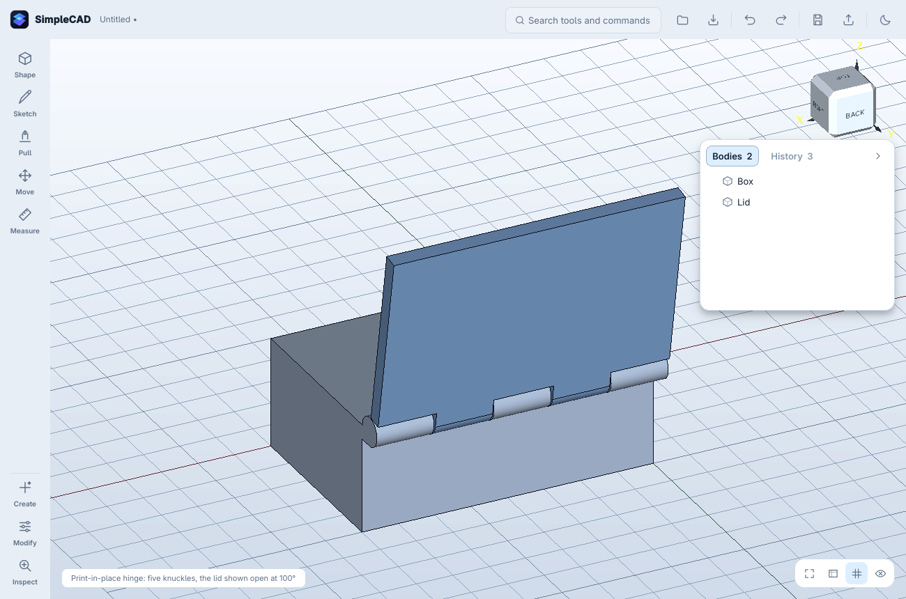

# Hinges

One feature, `hinge`. It is built from a straight edge on the part that stays
put and the part that swings. It can be edited from History or the context
bar, like a joint.

## Workflow

1. Select the box's top back edge and the lid (anything on it), then choose
   **Hinge**. It is offered in the context bar as soon as there is one edge
   and something on another part.
2. Choose the type and adjust the numbers. Each has a default.
3. Drag the **angle slider**, or press **Play**, to watch the lid swing
   through its range.
4. Apply. *Edit hinge…* reopens it.

`scripts/check_hinge.py` drives this through the real window, then turns the
built lid with booleans:

- clear of the box at 0, 45, 90 and 120°
- held on its pin

## Geometry (`kernel/hinge.py`)

**Frame.** Of the two flat faces meeting at the picked edge:

- The one facing the swinging part is the seam, the box top (normal `w`).
- The other is the back face (normal `u`).
- *Put the knuckles on the other face* swaps them.

The frame is made right-handed by running along the edge in the appropriate
direction. The axis lies on the seam plane, `knuckle radius + running gap`
outside the back face, so the lid swings up and back clear of the box to about
180°.

**Knuckles** alternate fixed / swinging along the hinge, separated by the axial
gap. Each is tied to its own part by a leaf that reaches from just inside that
part's back face to the axis, on its own side of the seam. Each knuckle is at
least 2 mm long, or the build is refused with the numbers.

**Types:**

| Type | Construction |
|---|---|
| Pin | Every knuckle is bored to pin + clearance. A separate pin body is output, named "Hinge pin" and kept unique, 0.2 mm short of each end |
| Print-in-place | The pin is fused into the fixed part along the whole hinge. The swinging knuckles are bored to pin + clearance. It cannot be pulled apart (tested) |
| Snap-on | As print-in-place, but the swinging knuckles have a mouth 0.85 × pin wide facing outward, so the lid presses on and comes off. The bending strain of the C is estimated as a quarter-ring cantilever, the same estimate the snap tabs use. Above 2% it warns to use PETG; above 4%, to use bigger knuckles or a thinner pin |
| Living | A thin strip (default 0.5 mm, 0.3–1.2 allowed) with pads on each side joins the parts into one print. The swinging part is consumed. Refused if the parts touch, which would print solid. Always warns that PLA cracks; PP, PETG or TPU suit |

**Stop** (optional) catches the lid at exactly the opening limit:

- A bar runs along the swinging part, outside the knuckles.
- A shoulder on the fixed knuckles is placed where the bar's leading face
  arrives at the limit.

Tested: clear at limit − 2°, colliding at limit + 4°.

**Swing check.**

- The swinging part is turned against the fixed one in 10° steps up to the
  limit (10–180°), then refined to 1° back from the first contact.
- A contact refuses the hinge: "Lid hits Box at 104° of its 120° swing", with
  suggestions.
- With a stop, the check also confirms that the stop catches.
- All of this runs in the geometry process during the preview.

**Other refusals:**

- a curved edge
- an edge without a flat face on both sides
- a hinge longer than its edge
- zero clearance (it would print fused)
- a pin that leaves less than the minimum wall in the knuckle
- an opening limit outside 10–180°

## Acceptance (`tests/test_hinge.py`)

| Test | Result |
|---|---|
| Pin, print-in-place and snap-on | Clear at 0, 45, 90 and 120°. Turning into the box collides. Opening lifts the lid front over 70 mm. The pin touches neither part |
| Print-in-place pulled 2 mm off | Collides |
| Stop at 100° | Clear at 98°, collides at 104° |
| A wall behind the box | Reported with its angle (95–170°); 5° less builds |
| Knuckle count 5 → 7 | Rebuilds, and survives save, reopen and forced rebuild |
| Oversized pin, or too many knuckles | Refused with the numbers |
| Living hinge on parts 0.6 mm apart | One valid body |
| Living hinge on touching parts | Refused |
| Hinge between the two halves of a split box | Built and valid |

## Known limits

- **Leaves**: the leaves are blocks the size of the knuckle radius. On a lid
  thinner than that, they stand proud of its top.
- **Snap-on strain** is an estimate, not a finite-element result.
- **Living hinge**: there is no fatigue model, only the material warning.
