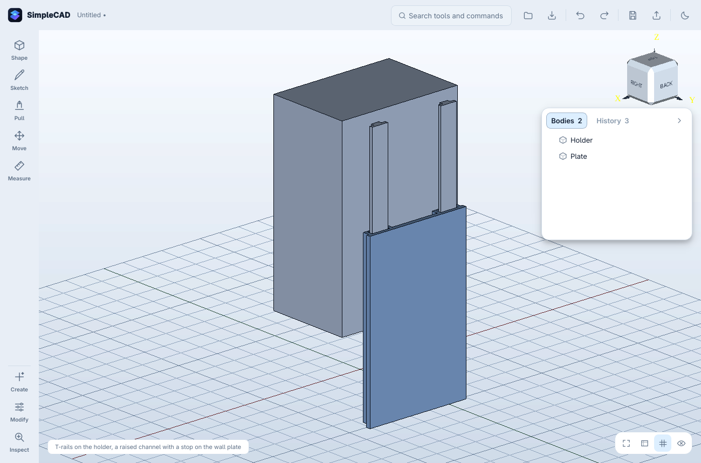

# Mechanical joints

One tool, **Joint** (formerly Clip / Join Parts), one feature, `clip_joint`.
Every style writes into both parts from a single history step that can be
reopened and edited.

| Style | Kind | Use |
|---|---|---|
| Snap tab | push-fit, cantilever hooks | Closing a split print. A strain check against PLA/PETG limits refuses arms that would crack |
| Printed connector | push-fit, separate clip | Pockets in both parts |
| Tab & slot | push-fit key with detent bumps | Thin walls |
| **Dovetail rail** | sliding | Removable covers, drawers, anything that must not lift off |
| **T-rail** | sliding | Wall brackets, accessories that drop into a mount (the reference image) |
| **Tongue & groove** | sliding, guided | Guides only: it locates but does not hold against lifting |

## Reference case

The reference is an open-top holder with two rails on its back. It drops into
L-lipped channels on a thin, screw-on plate and stops at the bottom. Through
the UI:

1. Select the holder's back face and the plate's front face, then choose
   **Joint**.
2. Choose **T-rail**. The fit switches to Sliding.
3. "Bring the parts together" is offered and ticked, because the parts are
   apart.
4. Pick a slide direction. The directions are named by world axis, for
   example *Slides in −Z (down)*. Automatic picks down on a wall.
5. A raised channel is chosen automatically, because a 2 mm plate cannot take
   a cut one.
6. Drag the **Assembled ↔ Apart** slider, or press **Play**, to watch the
   holder slide out and back.
7. Apply.

`scripts/check_joint_slide.py` drives exactly this through the window. It then
checks the built parts with booleans:

- Assembled: 0 mm³ overlap.
- Lifted by the full travel: 0 mm³.
- Pushed 1 mm further in: the stop catches.
- Pulled 1 mm off the wall: the channel holds.

## Geometry (`kernel/slides.py`)

**Canonical frame**: Z points out of the rail's part into its mate; X is the
direction the rail part moves to go in; Y is across the rail.

**Rail profiles** are 2-D polygons in (Y, Z):

| Style | Profile |
|---|---|
| Tongue & groove | A rectangle |
| Dovetail | A trapezoid, narrow at the face. The neck must stay ≥ 1 mm and ≥ 2× minimum wall; the flank angle must be 2–35° |
| T-rail | A stem half the rail width up to half height, then a full-width flange |

**Channel profile** is the rail profile grown by half the (total) clearance,
using a mitred offset. Every face, including the underside of a T flange and
a dovetail flank, gets exactly `clearance / 2` (tested).

**Channel modes:**

| Mode | Construction | Gap between faces |
|---|---|---|
| Cut | Channel sunk into the mate; only its deepest edge is pushed down by the depth clearance | 0 (faces touch) |
| Raised | Lip walls of width `lip` stand on the mate's face around the channel, starting `clearance / 2` above the rail part's face | rail height + `clearance / 2` |
| Automatic | Cut when the mate keeps `min_wall` behind the channel (checked with the same containment test the push-fit joints use); otherwise raised | — |

**Extras:**

- **Stop**: the channel is closed `clearance / 2` beyond the rail's end — a
  wall of `lip` (raised) or `min_wall` (cut).
- **Lead-in**: a lofted flare of `lead_in` at the open end.
- **Detent**: a half-round ridge across the rail top near the stop, and a
  dimple in the mate.
  - By default it stands 0.3 mm proud of whatever clearance is above the
    rail, so it clicks.
  - Set to 0 for none.
  - A detent inside the clearance is warned about.

**Rails**: 1–4 spread across the shared face, keeping their channel walls and
the edge offset clear of the edge. Each runs the whole shared length unless a
length is given. A hole or edge in a rail's path, too narrow a face, or under
2× rail width (min 6 mm) of engagement is refused with the numbers.

## Checks before anything is built

All of these run in the geometry process during the preview, so the window
never blocks:

| Check | Message |
|---|---|
| Clearance ≤ 0 | "will bind" |
| Neck, angle, stem, wall too small | The dimension that fails |
| Cut channel in a part that cannot take it (mode Cut) | "too thin … choose a raised channel" |
| Assembled overlap > 0.001 mm³ | The overlap volume |
| Slide-out sweep: the rail part is moved out in five steps to the full travel, and any collision fails | "cannot be slid apart: they collide 31.2 mm out" |
| Stop does not catch when pushed in | Warning |
| Short engagement (< 3× width) | Warning |
| Invalid result solids | Refused |

## Fits

- Presets are Snug, Sliding, Press and Loose. Loose is new, and it is now also
  accepted by the kernel.
- They resolve through `calibration.effective_fits`, so a printer that has
  been measured uses its own numbers.
- The panel says presets are starting points that depend on material, process
  and calibration.

## Acceptance (`tests/test_joints_sliding.py`)

| Test | Result |
|---|---|
| Each style, raised on a 2 mm plate | No overlap; lifts out freely at 5 mm, 30 mm and the full travel; the stop catches; dovetail and T-rail hold against pulling off |
| Each style, cut into a 10 mm plate | Faces touching, nothing added to the plate, slides out |
| Cut forced on a thin plate | Refused, with the reason |
| A shelf over the open end | Refused before building |
| Reversed slide direction | Exits the other way |
| Clearance | Exactly half on every face; rectangular widths grow by exactly the clearance |
| Zero clearance, or a dovetail with no neck | Refused |
| Detent | Home: no overlap. 5 mm out: a small press. Free at full travel |
| Clearance edited from 0.3 to 0.8 | Rebuilds, and survives save → reopen → forced rebuild |

## Known limits

- **Seam**: the rail part's face and the mate's face must be flat and facing
  each other.
- **Rail placement** is automatic across the shared face. There is no
  click-to-place for rails.
- **Detent pressure**: the detent is checked to clear when the joint is
  assembled and when it is fully out. Between those it is meant to press, and
  how hard is not computed.
